




<a href="https://github.com/HarshaVardhan3002/Nimbus_revanced"></a>
<a href="https://github.com/HarshaVardhan3002/zunzun"></a>
<a href="https://github.com/HarshaVardhan3002/nimbus"></a>
<a href="https://github.com/HarshaVardhan3002/Daimon"></a>
<a href="https://github.com/HarshaVardhan3002/SCIONfit"></a>
<a href="https://github.com/HarshaVardhan3002/HCR-EV"></a>
<a href="https://harshavardhan3002.github.io/namma-office-downloads/"></a>
<a href="https://github.com/HarshaVardhan3002/ROCmFPX">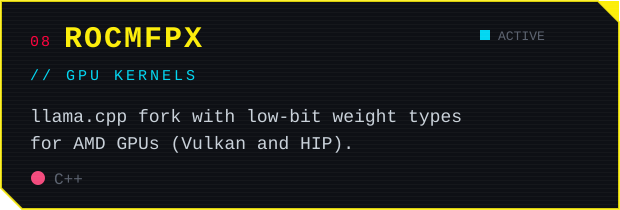</a>


<a href="https://huggingface.co/Harsha001"></a>






